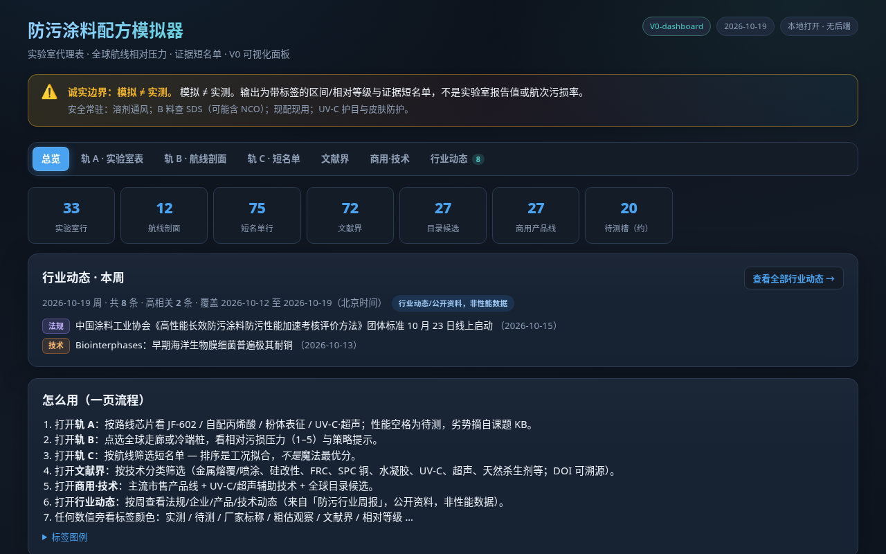
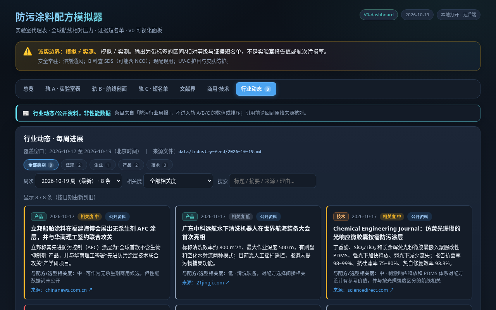
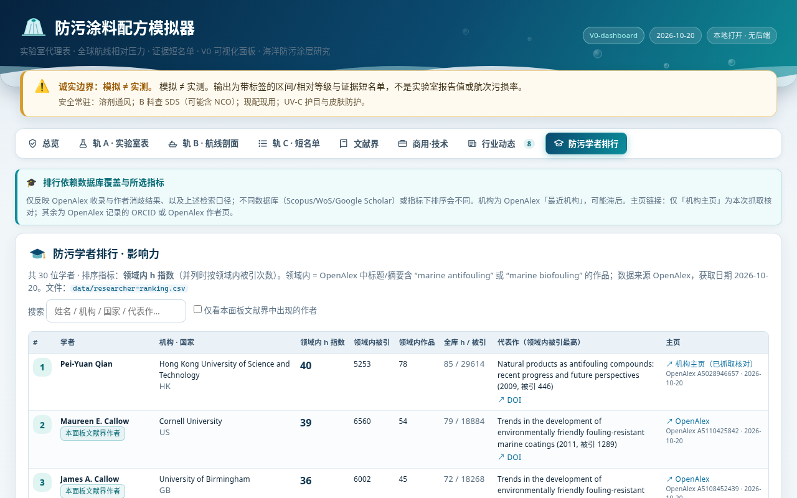

# 防污涂料配方模拟器 / Antifouling Coating Simulator

**作者 Author：** 洪鹤庭 Hong Heting（Jassyhong）  
**建议仓库名 Suggested repo name：** `antifouling-coating-simulator`  
**许可证 License：** MIT（见 `LICENSE`）

本地优先的防污涂层**证据面板**（模拟器）：把实验室代理表、航线相对污损压力、公开文献/商用目录与行业动态放在同一界面里浏览。  
**核心原则：模拟 ≠ 实测。** 每个数值/结论必须带诚实标签。

> **English summary:** An AI-assisted antifouling coating formulation *simulator panel* (not a measurement instrument). Track A = lab proxy table, Track B = route fouling-pressure profiles (relative), Track C = evidence shortlists, plus literature bounds, commercial tech catalogue, weekly industry feed, and scholar ranking. Public-repo Track A / Track C rows are **example data**, not the author’s unpublished thesis results.

## 诚实标签（节选）

| 标签 | 含义 |
|---|---|
| 实测 | 本项目已完成并记录的测量 |
| 厂家标称 | 厂商 TDS/宣传区间，不可直接当改性样板真值 |
| 文献界 | 公开论文/标准给出的界或范围 |
| 相对等级 | 仅排序/相对强弱，不是绝对污损率 |
| 待测 / 方案非实测 | 槽位或方法设计，尚无数字 |
| 粗估观察 | 半定量目视等，不可当论文真值 |
| 公开资料 / 行业动态 | 公开网页或周报摘要 |
| **示例数据 / example** | **本公开仓库演示用；非作者课题数据** |

## 功能模块

1. **轨 A · 实验室表** — 配方槽位与性能栏（公开仓库为虚构示例行）
2. **轨 B · 航线** — 相对污损压力与示意图（非 AIS）
3. **轨 C · 短名单** — 按航线对公开品类做定性拟合
4. **文献界** — DOI / OpenAlex 元数据与主观重要度星级
5. **商用·技术** — 厂家公开目录与 UV-C/超声技术摘录
6. **行业动态** — 周报驱动的公开进展时间线
7. **防污学者排行** — OpenAlex 领域影响力示意
8. **技术交流**（仅手机 App，0.6.0+）— 基于本仓库 [GitHub Discussions](https://github.com/hongheting/antifouling-coating-simulator/discussions)，分「新技术 / 新配方 / 新工艺」三类，学者可用 GitHub 账号登录发帖、评论；没有 GitHub 账号也可**游客投稿**（经 Cloudflare Worker 中继，立即发布，见 [relay/](relay/README.md)）；所有帖子标注 **「作者自述，未经验证」**。详见 [docs/tech-exchange.md](docs/tech-exchange.md)。
   *Tech Exchange (mobile 0.6.0+): researchers post new antifouling technologies / formulations / processes as GitHub Discussions and comment in-app (GitHub device-flow login, or guest posting via a Cloudflare Worker relay without an account). Every post is labelled "self-reported, not verified". Report abuse via GitHub's "Report content"; the maintainer moderates on GitHub.*

## 截图

| 总览 | 行业动态 | 学者 |
|---|---|---|
|  |  |  |

更多见 `docs/screenshots/`。

## 示例数据声明（重要）

仓库内 **`data/lab-proxy-table.csv`**、**`data/recommendation-shortlist.csv`** 及对应 `recommendation-*-V0.md` 为 **示例数据**，用于演示 UI/标签结构。  
**不是**作者未发表课题的 JF 系配方、微宇宙数字或内部知识库内容。说明见 `docs/example-data.md`。

文献 DOI、商用公开信息、行业周报摘要、学者公开画像、航线几何等可公开资料予以保留。

## 目录结构

```
ui/                 # 单页 HTML + data-snapshot.js
data/               # CSV/MD 数据源（轨 A/C 示例化）
desktop/            # Electron
mobile/             # Capacitor Android + iOS 工程源码
docs/               # 说明与截图
DESIGN.md           # 公开版设计要点
```

## 构建

### 桌面（Electron）

```bash
cd desktop
npm install
npm start          # 开发
npm run dist:win   # Windows 包（需在 Windows 或配置好的 CI）
```

### Android（Capacitor）

需要 JDK 17/21 + Android SDK（platforms;android-34, build-tools）。

```bash
cd mobile
npm install
npm run apk        # 生成 debug APK → dist/
# adb install -r dist/coating-simulator-0.4.0.apk
```

### 界面热更新 / Live updates (0.6.0+)
App 内置自建 OTA：界面和 JS 改动打成签名包放在 `public-data/web/`，已装 App 启动时自动下载、验签（Ed25519 + SHA-256），重启生效，失败自动回滚；不使用 Capgo 云、不上报统计。发布：`cd mobile && npm run ota -- --notes "…"`，详见 [docs/auto-update.md](docs/auto-update.md)。注意：`public-data/web/` 的包含作者真实数据（与发布的 APK 相同）。
*Self-hosted signed OTA web bundles (Ed25519 + SHA-256, auto-rollback, no telemetry). Note: bundles contain the author's real data, same as the released APK.*

### iOS（需 macOS + Xcode）

本仓库已包含 `mobile/ios/` Xcode 工程（bundle id `com.hongheting.coatingsimulator`）。  
Linux/CI **不能**产出 IPA；请在 Mac 上：

```bash
cd mobile
npm install
npm run sync-www
npx cap sync ios
npx cap open ios   # 用 Xcode 选队签名后 Run / Archive
# 若缺 CocoaPods：sudo gem install cocoapods && cd ios/App && pod install
```

状态栏：Light content；Web 使用 safe-area；与 Android 一样由 `mobile-bridge.js` 处理外链与返回手势。

### 仅浏览器

```bash
python3 ui/rebuild-snapshot.py
# 用浏览器打开 ui/index.html
```

## 数据来源（公开）

- 文献元数据：OpenAlex / Crossref（见 enrichment CSV 时间戳）
- 航线底图：Natural Earth 派生（`world-land.js`）
- 行业动态：公开新闻/通稿摘要（`data/industry-feed/`）
- 学者：OpenAlex 公开作者统计

## 联系

由洪鹤庭 Jassyhong 开发，有疑问请联系 [17607144929](tel:17607144929)。

## Disclaimer

本软件仅供研究浏览与教学演示。不构成施工、采购或合规建议。海洋防污涉及生物杀伤剂法规与船级社要求时，请以当地法规与厂家最新 TDS/SDS 为准。
