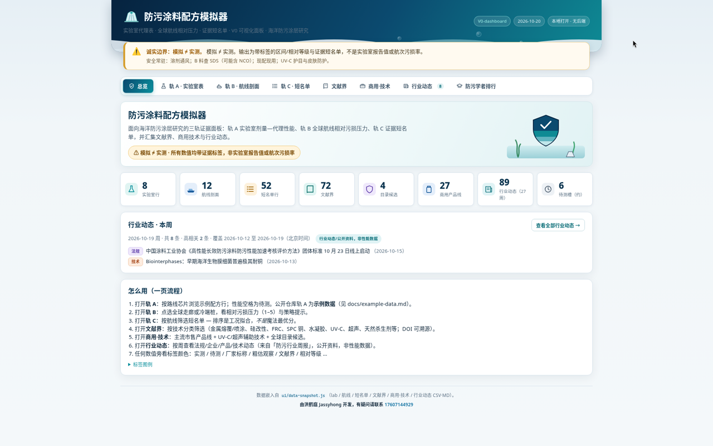
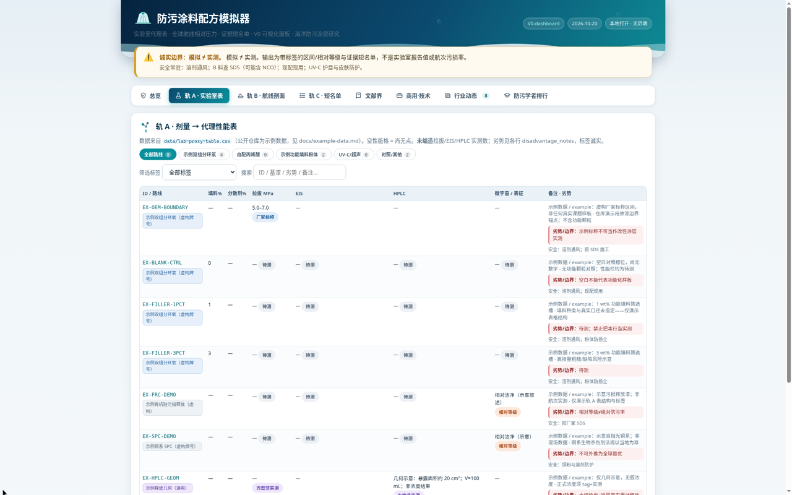
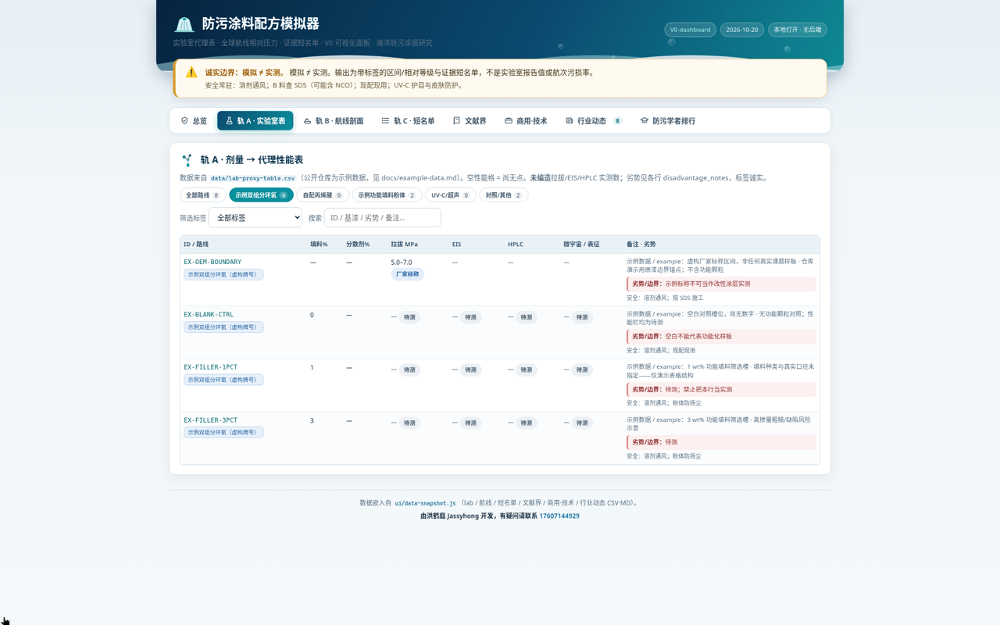
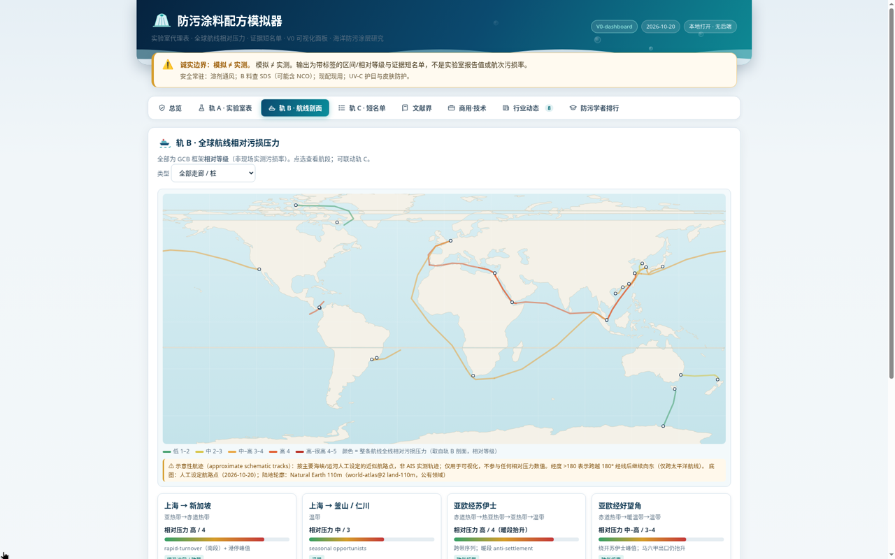
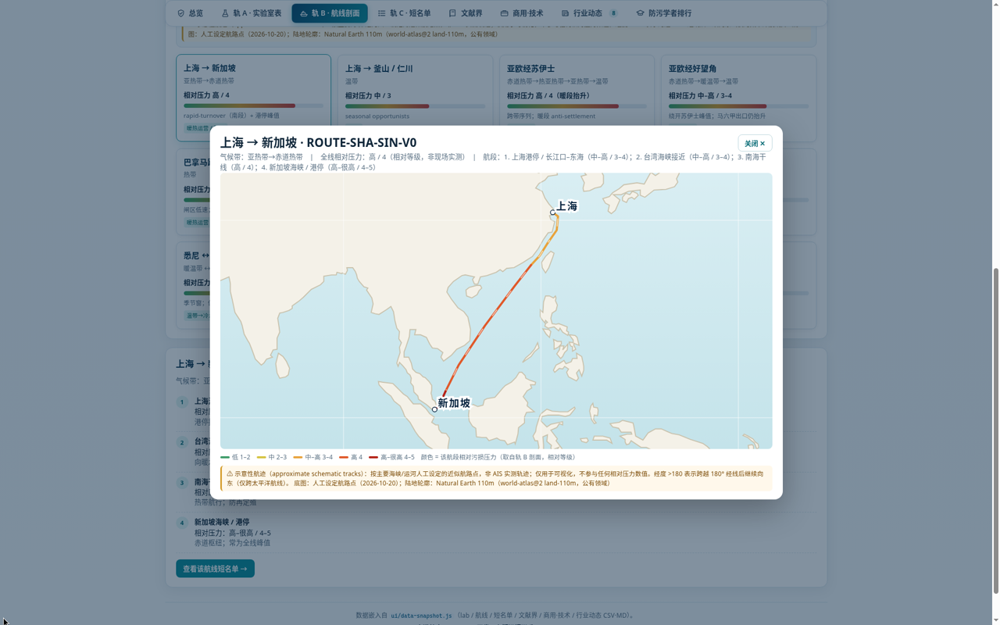
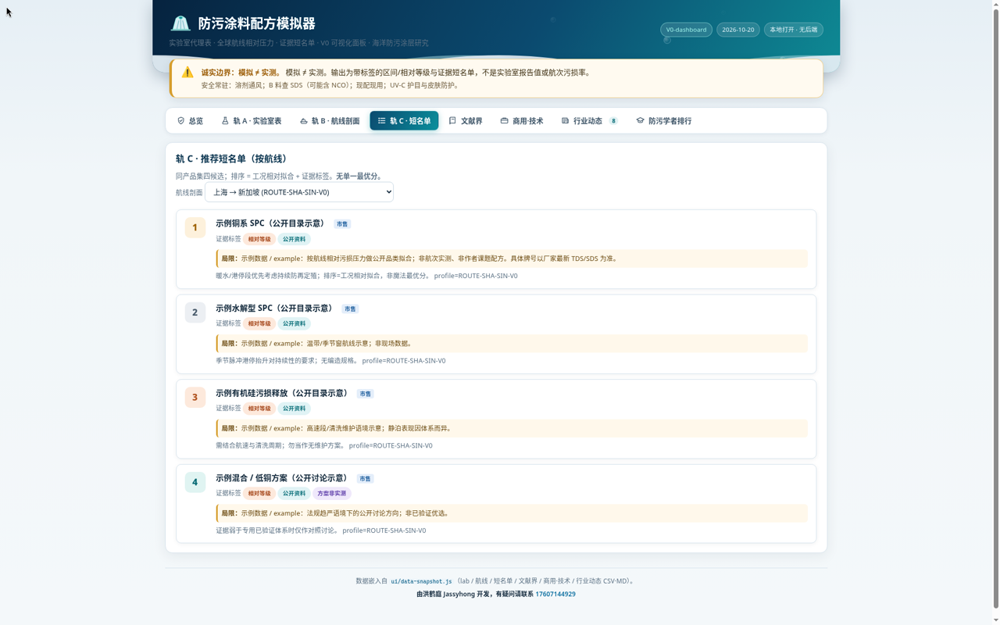

# 防污涂料配方模拟器 / Antifouling Coating Simulator

**作者 Author：** 洪鹤庭 Hong Heting（Jassyhong）  
**仓库：** [hongheting/antifouling-coating-simulator](https://github.com/hongheting/antifouling-coating-simulator)  
**许可证 License：** MIT（见 `LICENSE`）  
**当前版本：** 0.6.0（Windows / Android；微信小程序工具版）

本地优先的防污涂层**证据面板**（模拟器）：把实验室代理表、航线相对污损压力、公开文献/商用目录与行业动态放在同一界面里浏览。  
**核心原则：模拟 ≠ 实测。** 每个数值/结论必须带诚实标签——绝不把厂家标称、文献界或模型估计写成「已测」。

> **English:** An antifouling coating *evidence panel* (not a measurement instrument). **Track A** = lab dose→proxy table · **Track B** = route relative fouling-pressure profiles · **Track C** = evidence shortlists, plus literature bounds, commercial catalogue, weekly industry feed, and scholar ranking. Public-repo Track A / C rows are **example data**, not unpublished thesis results.



---

## 三轨是干什么的？

产品按「三轨」组织证据。用法通常是：**轨 A 看配方槽位 → 轨 B 选航线工况 → 轨 C 看该工况下的证据短名单**。三轨互为参照，没有单一「魔法最优分」。

| 轨 | 名称 | 回答的问题 | 诚实边界 |
|---|---|---|---|
| **A** | 实验室表 | 调了哪些剂量？代理性能栏现在有没有数、标签是什么？ | 空格 = 待测；厂家区间 ≠ 改性样板实测 |
| **B** | 航线剖面 | 这条全球走廊 / 冷端桩的**相对**污损压力大概怎样？策略提示是什么？ | 相对等级（1–5），**不是** AIS 或现场污损率 |
| **C** | 证据短名单 | 给定航线剖面，公开品类/方案按工况怎么排相对拟合？ | 排序 = 工况拟合；公开仓库行为示例数据 |

---

### 轨 A · 实验室表（剂量 → 代理性能）

**做什么：** 把「基漆 / 填料掺量 / 分散剂 / 干膜厚度 / 基材」等配方输入，和「拉拔、EIS、HPLC、微宇宙」等**代理性能栏**摆在一张可筛选的表里。每列旁都有诚实标签（实测 / 厂家标称 / 待测 / 粗估观察…）。

**典型用途：**
- 按路线芯片筛选（示例双组分环氧、无铜丙烯酸、粉体表征、UV-C·超声协议等）
- 搜索配方 ID、劣势备注、安全提示
- 一眼区分「已有数字」和「尚无数据的筛选槽」

**数据：** `data/lab-proxy-table.csv`（公开仓库为**虚构示例行**，见 `docs/example-data.md`）

| 全部路线 | 按芯片筛选（示例双组分环氧） |
|---|---|
|  |  |

> 示意：顶栏常驻「模拟 ≠ 实测」；芯片按基漆/路线收窄表格；空性能格保持「待测」，不会填假数。

---

### 轨 B · 航线剖面（相对污损压力）

**做什么：** 基于 GCB growth–adhesion 框架，给出全球航运走廊与冷端桩的**相对污损压力**（1–5 或低/中/高）与策略提示（暖水偏抗沉降/防再定殖，温带看季节窗，冷端整体压力低但耐久与抗持久附着重要）。可点选航线，联动轨 C。

**典型用途：**
- 在示意地图 / 卡片上浏览 10+ 条走廊与极地冷端桩
- 打开单航线详情，看区段压力与定性策略（非处方）
- 记住：港停相对压力 ≥ 航行（框架定性）；**禁止**把冷水写成「高污损」

**数据：** `data/climate-route-profile.md`、`data/gcb-route-inventory.md`；底图为 Natural Earth 派生几何（示意航迹，非 AIS）

| 全球航线总览（地图 + 卡片） | 单航线详情（上海 → 新加坡） |
|---|---|
|  |  |

---

### 轨 C · 证据短名单（按航线拟合）

**做什么：** 选定轨 B 的某个 `matched_profile_id` 后，给出该工况下的**相对**短名单：公开商用品类、技术路线或方案条目，带来源链接与 caveat。排序表达的是「和这条航线的相对压力/策略是否合拍」，**不是**实验室打分，更不是采购推荐。

**典型用途：**
- 下拉切换上海→新加坡、亚欧苏伊士、跨太平洋、冷端桩等剖面
- 阅读每条的证据标签与「示例数据 / 公开资料」声明
- 跳回轨 A 对照相关配方槽位（若有 `matched_track_A_id`）

**数据：** `data/recommendation-shortlist.csv` + 各 `data/recommendation-*-V0.md`（公开仓库为示例拟合）

| 暖水走廊（上海 → 新加坡） | 冷端桩（加拿大北极） |
|---|---|
|  |  |

> 示意：顶部下拉绑定轨 B 的 `matched_profile_id`；每行带证据标签与 caveat，公开仓库标明「示例数据」。

---

## 其他模块（一览）

| 模块 | 作用 | 示意 |
|---|---|---|
| **文献界** | DOI / OpenAlex 元数据与主观重要度；技术分类芯片 |  |
| **商用·技术** | 厂家公开目录 + UV-C/超声等技术摘录 |  |
| **行业动态** | 周报驱动的公开进展时间线（法规/企业/产品/技术） |  |
| **防污学者** | OpenAlex 领域影响力示意排行 |  |
| **技术交流** | 手机 / 桌面 App 0.6.0+：GitHub Discussions（新技术/新配方/新工艺）；可游客投稿 | 见 [docs/tech-exchange.md](docs/tech-exchange.md) |

更多截图见 [`docs/screenshots/`](docs/screenshots/)。

---

## 诚实标签（节选）

| 标签 | 含义 |
|---|---|
| 实测 | 本项目已完成并记录的测量 |
| 厂家标称 | 厂商 TDS/宣传区间，不可直接当改性样板真值 |
| 文献界 | 公开论文/标准给出的界或范围 |
| 相对等级 | 仅排序/相对强弱，不是绝对污损率 |
| 待测 / 方案非实测 | 槽位或方法设计，尚无数字 |
| 粗估观察 | 半定量目视等，不可当论文真值 |
| 公开资料 / 行业动态 | 公开网页或周报摘要 |
| **示例数据 / example** | **本公开仓库演示用；非作者课题数据** |

---

## 发布形态

| 形态 | 说明 |
|---|---|
| **Windows 桌面** | Electron 0.6.0：与手机同一界面；技术交流、在线数据更新、新版本提醒、**签名热更新**（Ed25519，未签名一律拒绝）。[Release 安装包](https://github.com/hongheting/antifouling-coating-simulator/releases/tag/v0.6.0) |
| **Android / iOS** | Capacitor；APK 见同一 Release；iOS 需本机 Xcode 签名 |
| **微信小程序** | `miniprogram/` 个人主体工具版：数据内置、不联网、无 UGC；航线页含离线 canvas 示意地图 |
| **仅浏览器** | 打开 `ui/index.html`（需同目录 `data-snapshot.js`） |

---

## 目录结构

```
ui/                 # 单页 HTML + data-snapshot.js
data/               # CSV/MD 数据源（轨 A/C 示例化）
desktop/            # Electron（共用 mobile/www UI）
mobile/             # Capacitor Android + iOS
miniprogram/        # 微信小程序工具版
public-data/        # 公开数据与 OTA 清单（Release 侧）
relay/              # 游客投稿 Cloudflare Worker
docs/               # 说明与截图
DESIGN.md           # 公开版设计要点
```

---

## 构建

### 桌面（Electron）

```bash
cd mobile && npm i && npm run sync-www && cd ..
cd desktop
npm install
npm run sync-ui    # mobile/www → desktop/ui
npm test           # OTA 签名校验单测
npm start
npm run dist:win   # NSIS 安装版 + 便携版
```

详见 [desktop/README.md](desktop/README.md)。

### Android（Capacitor）

```bash
cd mobile
npm install
npm run apk        # → dist/
```

界面热更新：`cd mobile && npm run ota -- --notes "…"`，见 [docs/auto-update.md](docs/auto-update.md)。

### 微信小程序

```bash
cd miniprogram && npm i && npm run data && npm test
```

用微信开发者工具导入 `miniprogram/`，把 `project.config.json` 的 `touristappid` 换成自己的 AppID。说明见 [miniprogram/README.md](miniprogram/README.md)。

### 仅浏览器

```bash
python3 ui/rebuild-snapshot.py
# 打开 ui/index.html
```

---

## 示例数据声明（重要）

仓库内 **`data/lab-proxy-table.csv`**、**`data/recommendation-shortlist.csv`** 及对应 `recommendation-*-V0.md` 为 **示例数据**，用于演示 UI/标签结构。  
**不是**作者未发表课题的配方、微宇宙数字或内部知识库内容。说明见 `docs/example-data.md`。

文献 DOI、商用公开信息、行业周报摘要、学者公开画像、航线几何等可公开资料予以保留。

---

## 数据来源（公开）

- 文献元数据：OpenAlex / Crossref
- 航线底图：Natural Earth 派生（`world-land.js`）
- 行业动态：公开新闻/通稿摘要（`data/industry-feed/`）
- 学者：OpenAlex 公开作者统计
- 航线框架：GCB growth–adhesion 策略空间（相对等级，非现场实测）

---

## 联系与免责声明

由洪鹤庭 Jassyhong 开发。技术交流请走本仓库 [Discussions](https://github.com/hongheting/antifouling-coating-simulator/discussions)。

本软件仅供研究浏览与教学演示。不构成施工、采购或合规建议。海洋防污涉及生物杀伤剂法规与船级社要求时，请以当地法规与厂家最新 TDS/SDS 为准。
