# MarineCoatSim · Antifouling Coating Simulator

[](https://simulator.jassyhong.top)
[](https://simulator.jassyhong.top)
[](https://github.com/hongheting/antifouling-coating-simulator/releases/tag/v0.6.0)
[](LICENSE)
[](https://github.com/hongheting/antifouling-coating-simulator/stargazers)

**English** · [简体中文](README.zh-CN.md)

An open evidence bench for **marine antifouling coatings**: dose tables, global route biofouling stress, literature bounds, commercial catalogues, and a formulation sandbox — in one panel.

Built for coating formulators, biofouling researchers, and anyone who has to compare a lab slot, a shipping corridor, and a vendor datasheet without pretending they are the same kind of evidence.

**[Open the live panel](https://simulator.jassyhong.top)** · also linked from the tools card on [jassyhong.top/tools.html](https://jassyhong.top/tools.html)

**Simulation ≠ measurement.** Every number wears an honesty tag. An OEM nominal, a literature bound, or a model envelope is never presented as a measured result.

Author: **Hong Heting** (洪鹤庭 / Jassyhong) · MIT · [Discussions](https://github.com/hongheting/antifouling-coating-simulator/discussions)

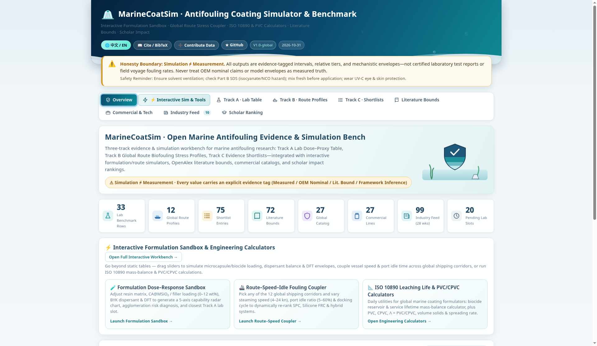

---

## What you can do with it

| Module | Question it answers |
|---|---|
| **Formulation sandbox** | If I change filler loading, dispersant, and dry-film thickness, what *envelope* should I expect — and which Track A slot is nearest? |
| **Track A · Lab table** | Which dose slots exist, and which performance cells are still empty? |
| **Track B · Routes** | What is the *relative* fouling-pressure profile of this corridor? |
| **Track C · Shortlist** | Given that profile, how do public classes line up — as a fit, not a score? |
| **Literature bounds** | What ranges do published papers and standards actually report? |
| **Commercial catalogue** | What do vendors state in public TDS and brochures? |
| **Industry feed** | What changed in regulations, products, and methods this week? |
| **Scholars** | Who shows up in OpenAlex for marine antifouling / biofouling? |
| **Discussions** | Where do new methods, formulations, and processes get talked about in public? |

There is no single magic optimum. The usual path is sandbox or Track A → Track B → Track C, with the tag on each cell kept visible.

---

## Formulation sandbox

First-class module on the **Interactive simulator** tab (web panel 0.6.1). Move the dose controls and the panel redraws three linked views:

1. **Dose–response sandbox** — resin family, active filler loading, dispersant level, DFT, and substrate. You get a five-axis radar (adhesion, release continuity, smoothness, barrier, static antifouling), an agglomeration / roughness risk, and the nearest Track A slot.
2. **Route–speed–idle coupler** — pick one of 12 corridors, then vary steaming speed, port-idle share, docking cycle, and optional UV-C or ultrasound. Technology classes are re-ranked as a *relative fit* under the GCB growth–adhesion frame.
3. **Engineering calculators** — ISO 10890 / CEPE mass-balance leaching life and minimum DFT, plus PVC/CPVC, volume solids, and theoretical spreading rate.

Every sandbox output is tagged **framework inference / model envelope**. It is a screening picture for formulators, not an ISO 4624 pull-off report, an HPLC flux, or a dry-dock inspection. The live panel’s formulation sandbox is shown below.

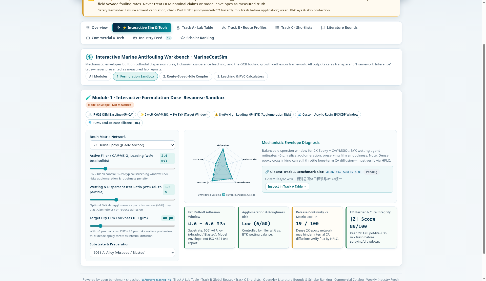

---

## Three tracks

| Track | Name | What it is for | Honesty boundary |
|---|---|---|---|
| **A** | Lab dose → proxy table | Dose inputs beside pull-off, EIS, HPLC, and microcosm columns | Empty cell = not yet measured. An OEM range is not a result on a modified panel |
| **B** | Route profiles | Relative fouling pressure (about 1–5) and a qualitative strategy hint for global corridors and cold-end stubs | Relative tier. Not AIS, and not a field fouling rate |
| **C** | Evidence shortlist | Public classes ordered by fit to the selected route profile | Order = working-condition fit. Not a lab score and not a purchasing recommendation |

### Track A · Lab table

Filter by route chip, search an ID or a note, and see which cells already have a number. In **this repository** the rows are example slots (`data/lab-proxy-table.csv`). See [Example data](#example-data).

| All routes | Filtered |
|---|---|
| 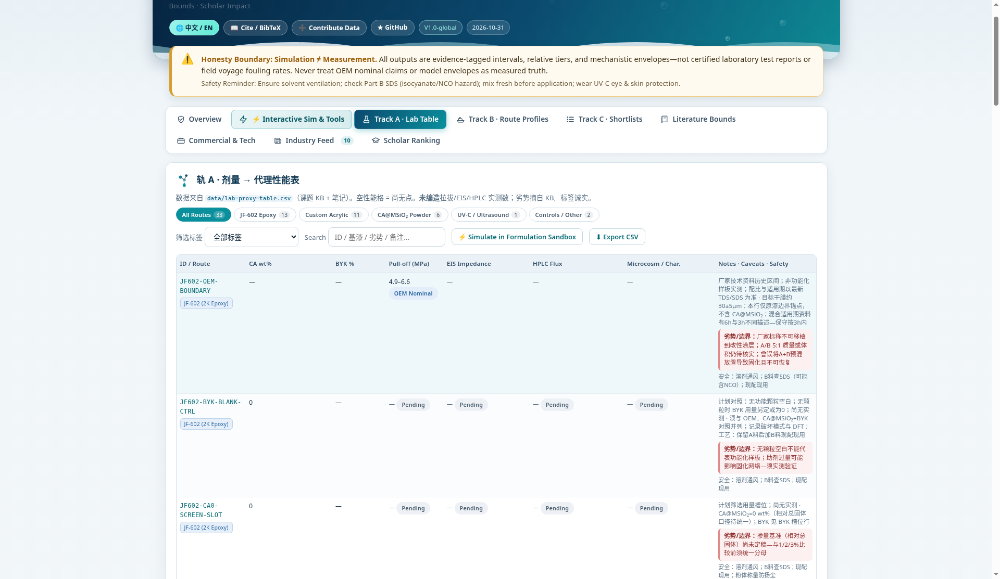 | 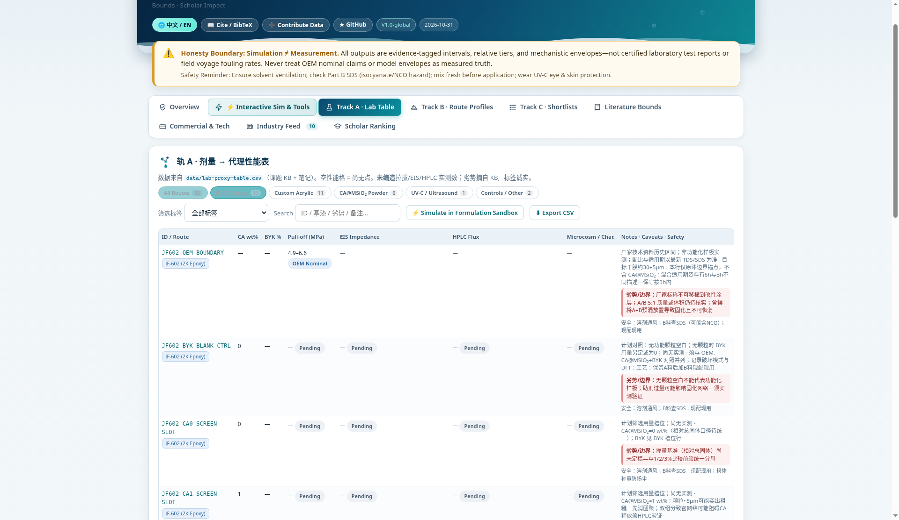 |

### Track B · Route profiles

Relative pressure from a GCB-style growth–adhesion frame: warm water leans toward anti-settlement, temperate water toward the seasonal window, cold ends stay low-pressure with durability and persistent attachment still in view. Port dwell is at least as stressful as steaming. Cold water is not drawn as “high fouling.” Tracks are schematic (Natural Earth coastline), not AIS.

| Corridor map | One route (Shanghai → Singapore) |
|---|---|
| 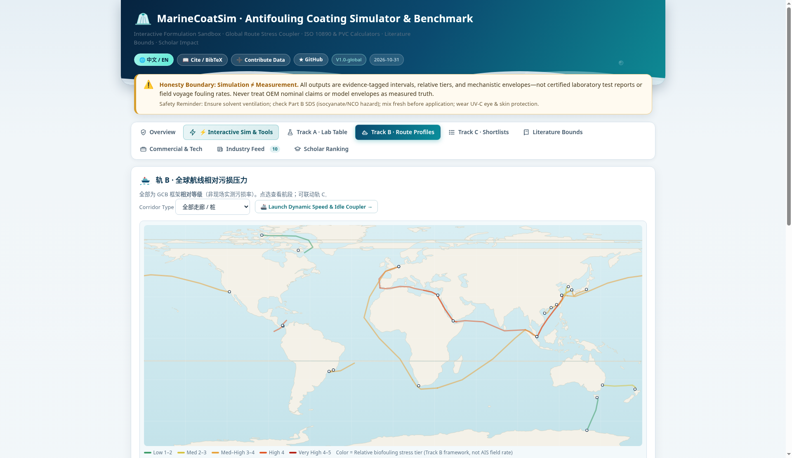 | 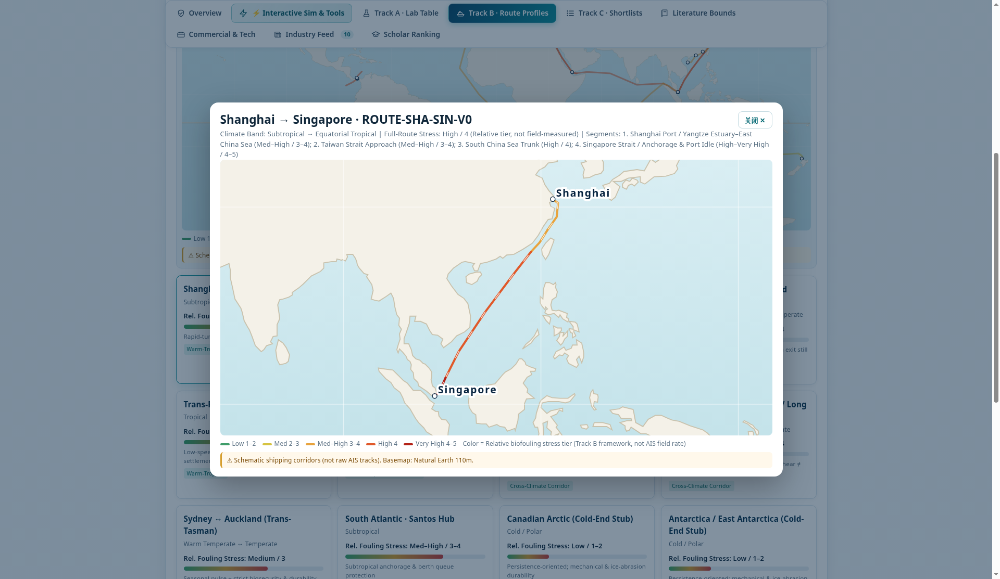 |

### Track C · Shortlist

Choose a Track B `matched_profile_id`. Each row carries a source link and a caveat. In this repository the shortlist is an example fit, not an unpublished formulation ranking.

| Warm corridor | Cold-end stub |
|---|---|
| 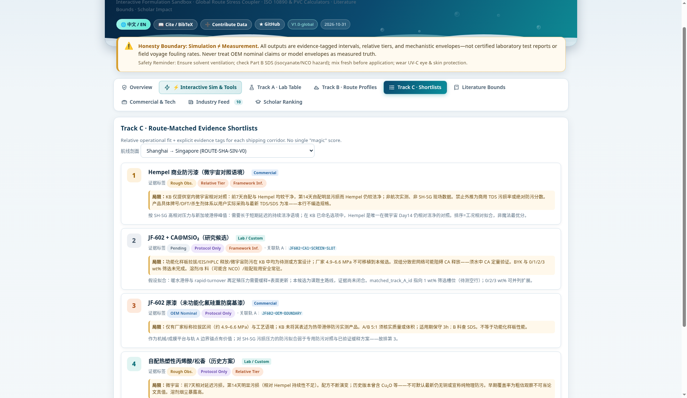 | 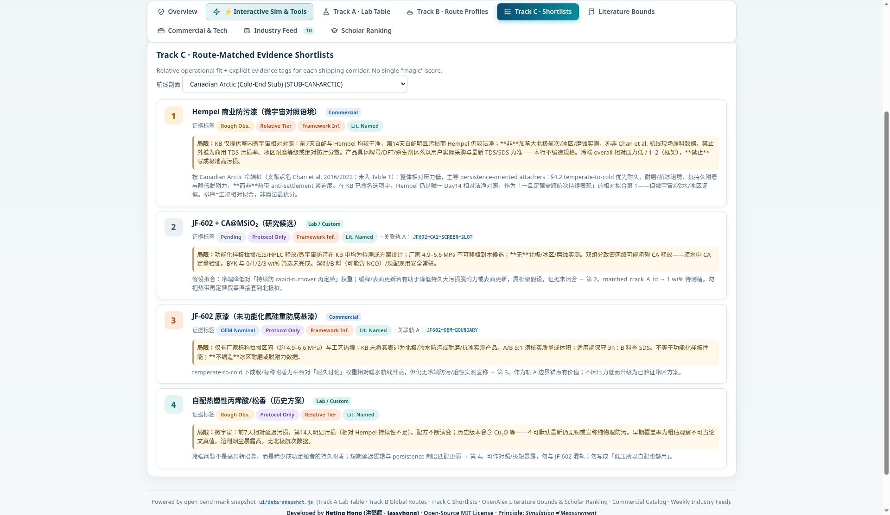 |

---

## Literature, catalogue, industry, scholars

| Module | Role | Shot |
|---|---|---|
| **Literature bounds** | DOI / OpenAlex metadata and a subjective importance mark. A bound from a paper is not this ship’s performance | 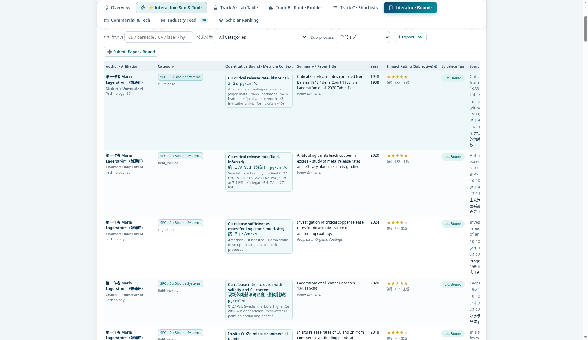 |
| **Commercial & technology** | Public vendor catalogue plus UV-C / ultrasound notes. Vendor claims stay tagged as OEM nominals | 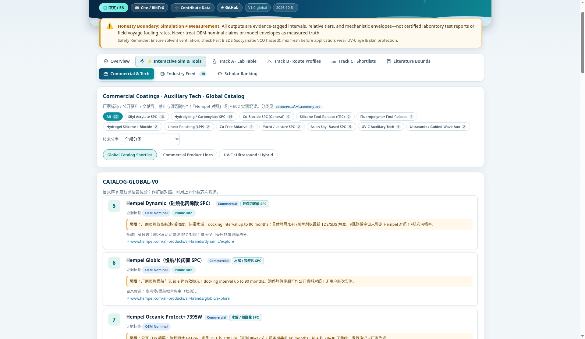 |
| **Industry feed** | Weekly public timeline (regulation, company, product, technology) | 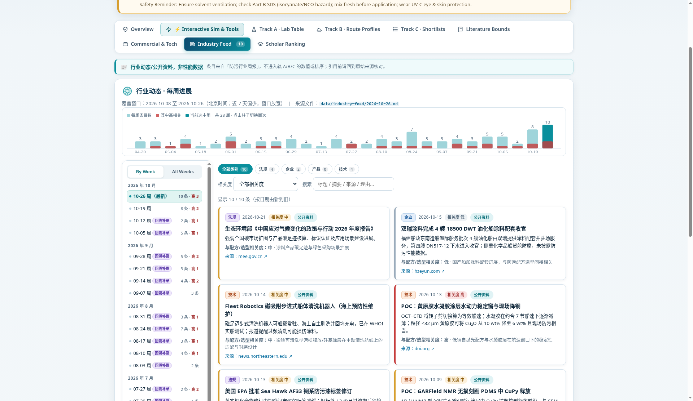 |
| **Scholars** | OpenAlex field impact, illustrative ranking only | 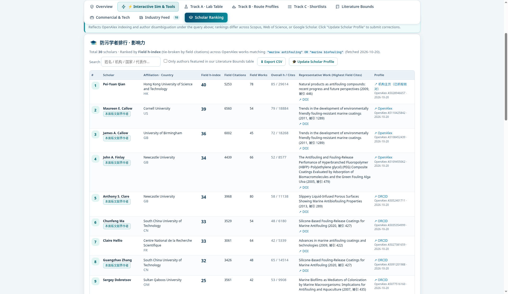 |
| **Tech exchange** | [GitHub Discussions](https://github.com/hongheting/antifouling-coating-simulator/discussions) for new technology, formulations, and processes. Posts are author statements, not verified data. Desktop and Android 0.6.0 also include an in-app exchange tab | [docs/tech-exchange.md](docs/tech-exchange.md) |

More images: [`docs/screenshots/en/`](docs/screenshots/en/).

---

## Honesty tags

| Tag | Meaning |
|---|---|
| Measured (实测) | A measurement this project recorded |
| OEM nominal (厂家标称) | A vendor TDS or brochure range. Not a value for a modified panel |
| Literature bound (文献界) | A range stated by a paper or a standard |
| Relative tier (相对等级) | Rank or relative strength, not an absolute fouling rate |
| Not yet measured / plan, not measured (待测 / 方案非实测) | A slot or a method design, with no number yet |
| Rough observation (粗估观察) | Semi-quantitative visual note. Not a paper result |
| Framework inference (框架推断) | Model envelope from the sandbox or the route frame |
| Public source / industry note (公开资料 / 行业动态) | A public page or a weekly digest |
| **Example** | **Demonstration row in this public repository. Not the author’s unpublished lab set** |

---

## Platforms

| Platform | What you get |
|---|---|
| **Web 0.6.1** | Live panel at [simulator.jassyhong.top](https://simulator.jassyhong.top). Static nginx image `coating-simulator-web:0.6.1` (`web/`). Chinese / English toggle in the header |
| **Windows 0.6.0** | Electron installer and portable build. Same family of UI as the phone app, plus signed UI hot-update (Ed25519; unsigned bundles are rejected). [Release](https://github.com/hongheting/antifouling-coating-simulator/releases/tag/v0.6.0) |
| **Android 0.6.0** | Capacitor APK on the same release |
| **iOS** | Capacitor project in `mobile/`. A signed build needs Xcode on a Mac; there is no App Store binary in v0.6.0 |
| **WeChat miniprogram** | `miniprogram/` tool build: data bundled, offline, no user-generated posts. Route page includes an offline canvas sketch map |

The **web panel is 0.6.1**. Desktop and Android **installers stay at 0.6.0** until the next app release. This pull request does not rebuild those binaries.

[Setup `.exe`](https://github.com/hongheting/antifouling-coating-simulator/releases/download/v0.6.0/AntifoulingCoatingSimulator-0.6.0-setup-x64.exe) · [Portable `.exe`](https://github.com/hongheting/antifouling-coating-simulator/releases/download/v0.6.0/AntifoulingCoatingSimulator-0.6.0-portable-x64.exe) · [APK](https://github.com/hongheting/antifouling-coating-simulator/releases/download/v0.6.0/coating-simulator-0.6.0.apk)

---

## Example data

`data/lab-proxy-table.csv`, `data/recommendation-shortlist.csv`, and the matching `recommendation-*-V0.md` files in **this git tree** are **example rows**. They demonstrate the table, the tags, and the shortlist layout. They are not the author’s unpublished formulations, microcosm figures, or internal notes.

Literature DOIs, the public commercial catalogue, weekly industry digests, scholar profiles, and route geometry stay as public material.

Published installers and OTA bundles can carry a fuller author dataset than these example files. The rule does not change with the dataset: tags stay on, and a model estimate is not a measurement. Detail: [docs/example-data.md](docs/example-data.md), [docs/auto-update.md](docs/auto-update.md).

---

## Run it locally

### Browser

```bash
python3 ui/rebuild-snapshot.py
# then open ui/index.html  (needs data-snapshot.js in the same folder)
```

### Web container

Build context is the **repository root** (the image copies only `ui/index.html`, `ui/data-snapshot.js`, and `ui/world-land.js`):

```bash
docker build --platform linux/amd64 -f web/Dockerfile -t coating-simulator-web:0.6.1 .
docker run --rm -p 8080:8080 -e PORT=8080 coating-simulator-web:0.6.1
curl -s http://127.0.0.1:8080/health
```

Notes for the existing Azure deploy: [web/DEPLOY-jassyhong.md](web/DEPLOY-jassyhong.md).

### Desktop (Electron)

```bash
cd mobile && npm i && npm run sync-www && cd ..
cd desktop
npm install
npm run sync-ui    # mobile/www → desktop/ui
npm test
npm start
```

`npm run dist:win` builds the NSIS installer and the portable exe. See [desktop/README.md](desktop/README.md). `desktop/ui/` is generated and gitignored.

### Android

```bash
cd mobile
npm install
npm run apk        # → dist/
```

UI hot update: `cd mobile && npm run ota -- --notes "…"`. See [docs/auto-update.md](docs/auto-update.md).

### WeChat miniprogram

```bash
cd miniprogram && npm i && npm run data && npm test
```

Import `miniprogram/` in WeChat DevTools and replace `touristappid` in `project.config.json`. See [miniprogram/README.md](miniprogram/README.md).

---

## Layout

```
ui/                 # single-page panel + data-snapshot.js
web/                # nginx image for the public site (context = repo root)
data/               # CSV/MD sources (Track A/C example rows)
desktop/            # Electron
mobile/             # Capacitor Android + iOS
miniprogram/        # WeChat tool build
public-data/        # public feed and OTA manifest
relay/              # guest-post Cloudflare Worker
docs/               # notes and screenshots
DESIGN.md           # public design notes
```

---

## Public sources

- Literature metadata: OpenAlex / Crossref
- Coastline: Natural Earth, via `world-land.js`
- Industry: public news and releases (`data/industry-feed/`)
- Scholars: OpenAlex author statistics
- Routes: GCB growth–adhesion strategy space (relative tiers, not a voyage log)

---

## Contact and disclaimer

Hong Heting (洪鹤庭 / Jassyhong). Technical exchange belongs in [Discussions](https://github.com/hongheting/antifouling-coating-simulator/discussions).

This software is for research browsing and teaching. It is not application advice, a purchasing specification, or a compliance opinion. Where a biocidal coating meets flag-state rules or a classification society, follow the current regulation and the vendor’s latest TDS/SDS.
