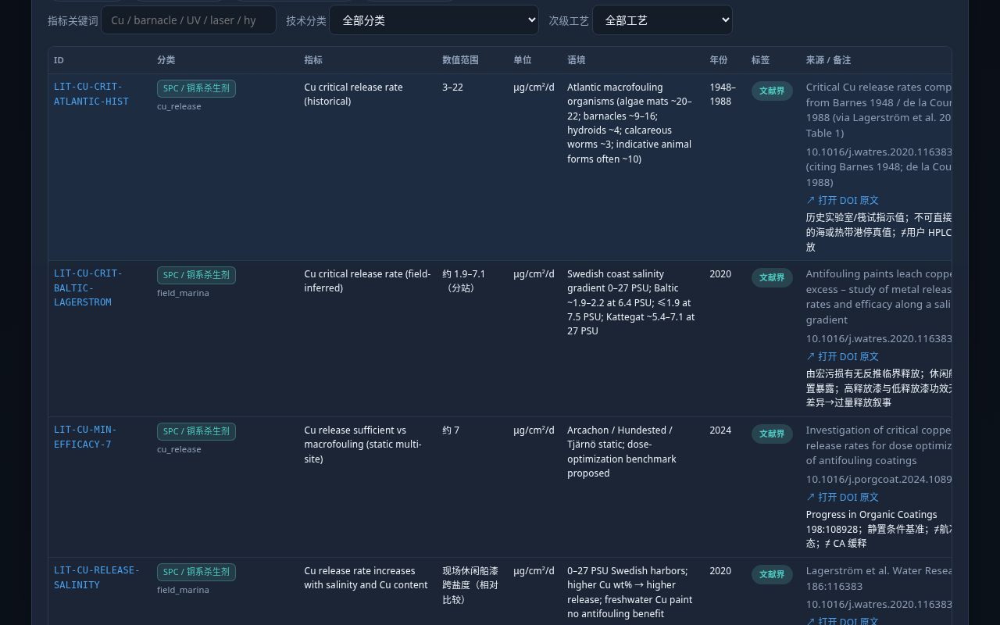
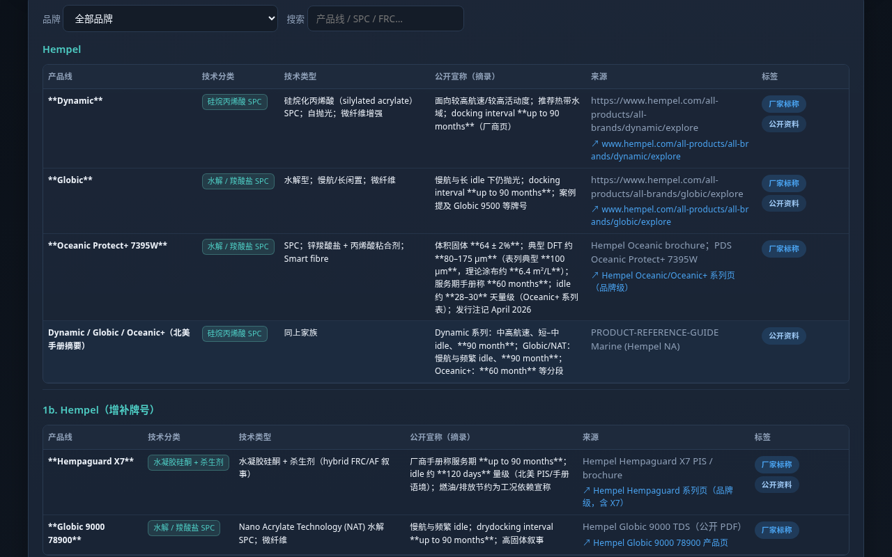

# 防污涂料配方模拟器 · MarineCoatSim

[](https://simulator.jassyhong.top)
[](https://simulator.jassyhong.top)
[](https://github.com/hongheting/antifouling-coating-simulator/releases/tag/v0.6.0)
[](LICENSE)
[](https://github.com/hongheting/antifouling-coating-simulator/stargazers)

**简体中文** · [English](README.md)

面向海洋防污涂层的开源**证据面板**：把剂量表、全球航线污损压力、文献上下界、商用目录和配方沙盒放在同一界面里。

给涂料配方工程师、生物污损研究人员，以及需要同时看实验室槽位、航线工况和厂家资料、又必须分清证据类型的人。

**[打开在线面板](https://simulator.jassyhong.top)** · 主站工具卡片见 [jassyhong.top/tools.html](https://jassyhong.top/tools.html)

**模拟 ≠ 实测。** 每个数值都带诚实标签。厂家标称、文献界、模型包络，都不会被写成已测数据。

作者：**洪鹤庭** Hong Heting（Jassyhong） · MIT · [讨论区](https://github.com/hongheting/antifouling-coating-simulator/discussions)


---

## 能用来做什么

| 模块 | 它回答的问题 |
|---|---|
| **配方沙盒** | 改了填料掺量、分散剂和干膜厚度，包络大概怎样？最近的轨 A 槽位是哪一行？ |
| **轨 A · 实验室表** | 有哪些剂量槽？哪些性能栏还是空的？ |
| **轨 B · 航线剖面** | 这条走廊的**相对**污损压力大致如何？ |
| **轨 C · 短名单** | 给定剖面，公开品类按工况怎么排相对拟合？ |
| **文献界** | 论文和标准公开写出的范围是什么？ |
| **商用目录** | 厂家在公开 TDS / 样本里怎么表述？ |
| **行业动态** | 这一周法规、产品和方法有什么公开进展？ |
| **学者** | OpenAlex 里海洋防污 / 生物污损方向有哪些作者？ |
| **讨论区** | 新技术、新配方、新工艺在哪里公开交流？ |

没有单一的「魔法最优分」。常见路径是沙盒或轨 A → 轨 B → 轨 C，并且让每个格子上的标签一直可见。

---

## 交互式配方沙盒

网页面板 0.6.1 的一级模块，在「交互模拟 · 计算器」页。拖动剂量控件，三块视图一起更新：

1. **配方剂量沙盒** — 树脂体系、活性填料掺量、分散剂、干膜厚度和基材。输出五维雷达（附着力、缓释连续性、平整度、屏障、静态抗污）、团聚 / 粗糙风险，以及最邻近的轨 A 槽位。
2. **航线—船速—港停耦合** — 在 12 条走廊里选一条，再调航速、港停比例、坞期，以及可选的 UV-C 或超声。各技术路线按 GCB 增长–脱附框架做**相对拟合**重排。
3. **工程计算器** — ISO 10890 / CEPE 质量平衡法估算释放寿命和最低干膜厚度；另有 PVC/CPVC、体积固含和理论涂布率。

沙盒输出一律标为**框架推断 / 模型包络**。它是配方筛选时的示意图，不是 ISO 4624 拉拔报告，不是 HPLC 通量，也不是坞修检查记录。`docs/screenshots/` 里还没有这一页的截图；下面保留的是较早的三轨、文献、商用和行业动态画面。

---

## 三轨

| 轨 | 名称 | 用途 | 诚实边界 |
|---|---|---|---|
| **A** | 剂量 → 代理性能表 | 剂量输入与拉拔、EIS、HPLC、微宇宙栏目并列 | 空格 = 待测。厂家区间不是改性样板的结果 |
| **B** | 航线剖面 | 全球走廊与冷端桩的相对污损压力（约 1–5）和定性策略提示 | 相对等级。不是 AIS，也不是现场污损率 |
| **C** | 证据短名单 | 按所选航线剖面对公开品类做相对拟合 | 排序 = 工况拟合。不是实验室打分，也不是采购推荐 |

### 轨 A · 实验室表

按路线芯片筛选，或搜索配方 ID 与备注，区分已有数字和空槽。**本仓库**中的行是示例槽位（`data/lab-proxy-table.csv`）。见 [示例数据](#示例数据)。

| 全部路线 | 按芯片筛选 |
|---|---|
|  |  |

### 轨 B · 航线剖面

相对压力来自 GCB 式增长–脱附框架：暖水偏抗沉降，温带看季节窗，冷端整体压力低，但耐久和抗持久附着仍然重要。港停不低于航行。冷水不会被画成「高污损」。航迹是示意（Natural Earth 岸线），不是 AIS。

| 走廊地图 | 单航线（上海 → 新加坡） |
|---|---|
|  |  |

### 轨 C · 短名单

选定轨 B 的 `matched_profile_id`。每一行带来源和 caveat。本仓库中的短名单是示例拟合，不是未发表配方的排名。

| 暖水走廊 | 冷端桩 |
|---|---|
|  |  |

---

## 文献、商用目录、行业动态、学者

| 模块 | 作用 | 示意 |
|---|---|---|
| **文献界** | DOI / OpenAlex 元数据与主观重要度。论文里的界不是本船性能 |  |
| **商用·技术** | 厂家公开目录，以及 UV-C / 超声摘录。厂家表述保持「厂家标称」 |  |
| **行业动态** | 按周整理的公开进展（法规、企业、产品、技术） |  |
| **学者** | OpenAlex 领域影响的示意排行 |  |
| **技术交流** | [GitHub Discussions](https://github.com/hongheting/antifouling-coating-simulator/discussions)：新技术、新配方、新工艺。帖子是作者自述，不是已核验数据。桌面和 Android 0.6.0 另有应用内交流页 | [docs/tech-exchange.md](docs/tech-exchange.md) |

更多截图见 [`docs/screenshots/`](docs/screenshots/)。

---

## 诚实标签

| 标签 | 含义 |
|---|---|
| 实测 | 本项目已记录的测量 |
| 厂家标称 | 厂商 TDS 或宣传区间，不能直接当作改性样板的真值 |
| 文献界 | 论文或标准给出的范围 |
| 相对等级 | 排序或相对强弱，不是绝对污损率 |
| 待测 / 方案非实测 | 槽位或方法设计，尚无数字 |
| 粗估观察 | 半定量目视，不能当作论文结果 |
| 框架推断 | 沙盒或航线框架给出的模型包络 |
| 公开资料 / 行业动态 | 公开网页或周报摘要 |
| **示例数据** | **本公开仓库的演示行，不是作者未发表的实验室数据** |

---

## 平台

| 平台 | 内容 |
|---|---|
| **网页 0.6.1** | 在线面板 [simulator.jassyhong.top](https://simulator.jassyhong.top)。静态 nginx 镜像 `coating-simulator-web:0.6.1`（`web/`）。页眉可切换中文 / English |
| **Windows 0.6.0** | Electron 安装版与便携版。界面与手机应用同一族，并带签名界面热更新（Ed25519，未签名包一律拒绝）。[Release](https://github.com/hongheting/antifouling-coating-simulator/releases/tag/v0.6.0) |
| **Android 0.6.0** | 同一 Release 中的 Capacitor APK |
| **iOS** | 工程在 `mobile/`。签名构建需要 Mac 上的 Xcode；v0.6.0 没有 App Store 安装包 |
| **微信小程序** | `miniprogram/` 工具版：数据内置、离线、无用户发帖。航线页含离线 canvas 示意地图 |

**网页面板是 0.6.1。** 桌面和 Android **安装包仍为 0.6.0**，留到下一次应用发布再更新。这次不同步重建这些二进制文件。

[安装版 `.exe`](https://github.com/hongheting/antifouling-coating-simulator/releases/download/v0.6.0/AntifoulingCoatingSimulator-0.6.0-setup-x64.exe) · [便携版 `.exe`](https://github.com/hongheting/antifouling-coating-simulator/releases/download/v0.6.0/AntifoulingCoatingSimulator-0.6.0-portable-x64.exe) · [APK](https://github.com/hongheting/antifouling-coating-simulator/releases/download/v0.6.0/coating-simulator-0.6.0.apk)

---

## 示例数据

本 git 树中的 `data/lab-proxy-table.csv`、`data/recommendation-shortlist.csv` 以及对应的 `recommendation-*-V0.md` 是**示例行**。它们用来演示表格、标签和短名单结构，不是作者未发表的配方、微宇宙数字或内部笔记。

文献 DOI、公开商用目录、行业周报、学者公开画像和航线几何保持为可公开资料。

已发布的安装包和 OTA 包可以带上比这些示例文件更完整的作者数据。换数据集也不改变规则：标签保留，模型估计不是实测。说明见 [docs/example-data.md](docs/example-data.md)、[docs/auto-update.md](docs/auto-update.md)。

---

## 本地运行

### 浏览器

```bash
python3 ui/rebuild-snapshot.py
# 然后打开 ui/index.html（同目录需要 data-snapshot.js）
```

### 网页容器

构建上下文是**仓库根目录**（镜像只复制 `ui/index.html`、`ui/data-snapshot.js`、`ui/world-land.js`）：

```bash
docker build --platform linux/amd64 -f web/Dockerfile -t coating-simulator-web:0.6.1 .
docker run --rm -p 8080:8080 -e PORT=8080 coating-simulator-web:0.6.1
curl -s http://127.0.0.1:8080/health
```

现有 Azure 部署笔记：[web/DEPLOY-jassyhong.md](web/DEPLOY-jassyhong.md)。

### 桌面（Electron）

```bash
cd mobile && npm i && npm run sync-www && cd ..
cd desktop
npm install
npm run sync-ui    # mobile/www → desktop/ui
npm test
npm start
```

`npm run dist:win` 会打出 NSIS 安装版和便携版。见 [desktop/README.md](desktop/README.md)。`desktop/ui/` 由脚本生成，且在 `.gitignore` 中。

### Android

```bash
cd mobile
npm install
npm run apk        # → dist/
```

界面热更新：`cd mobile && npm run ota -- --notes "…"`。见 [docs/auto-update.md](docs/auto-update.md)。

### 微信小程序

```bash
cd miniprogram && npm i && npm run data && npm test
```

用微信开发者工具导入 `miniprogram/`，并把 `project.config.json` 里的 `touristappid` 换成自己的 AppID。见 [miniprogram/README.md](miniprogram/README.md)。

---

## 目录

```
ui/                 # 单页面板 + data-snapshot.js
web/                # 公开站点的 nginx 镜像（上下文 = 仓库根）
data/               # CSV/MD 数据源（轨 A/C 为示例行）
desktop/            # Electron
mobile/             # Capacitor Android + iOS
miniprogram/        # 微信小程序工具版
public-data/        # 公开数据流与 OTA 清单
relay/              # 游客投稿用的 Cloudflare Worker
docs/               # 说明与截图
DESIGN.md           # 公开版设计要点
```

---

## 公开数据来源

- 文献元数据：OpenAlex / Crossref
- 岸线：Natural Earth（`world-land.js`）
- 行业动态：公开新闻与通稿（`data/industry-feed/`）
- 学者：OpenAlex 作者统计
- 航线：GCB 增长–脱附策略空间（相对等级，不是航次记录）

---

## 联系与免责声明

洪鹤庭 Hong Heting（Jassyhong）。技术交流请用本仓库 [Discussions](https://github.com/hongheting/antifouling-coating-simulator/discussions)。

本软件供研究浏览和教学演示，不构成施工、采购或合规意见。海洋防污涉及生物杀伤剂法规或船级社要求时，以当地现行规定和厂家最新 TDS/SDS 为准。
